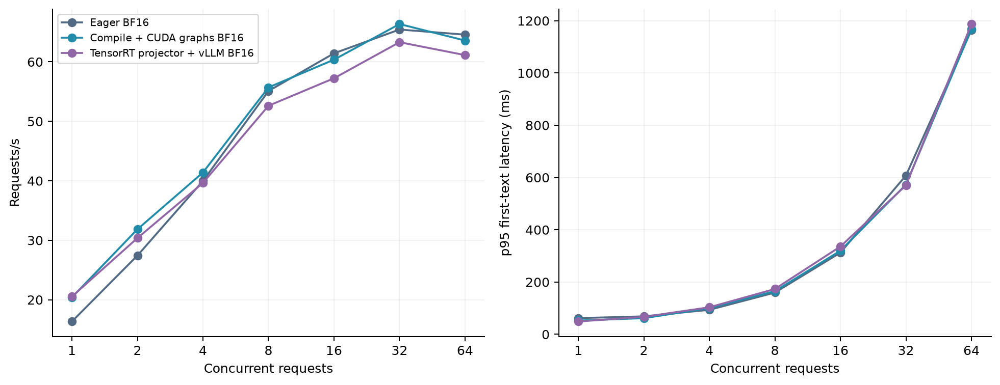
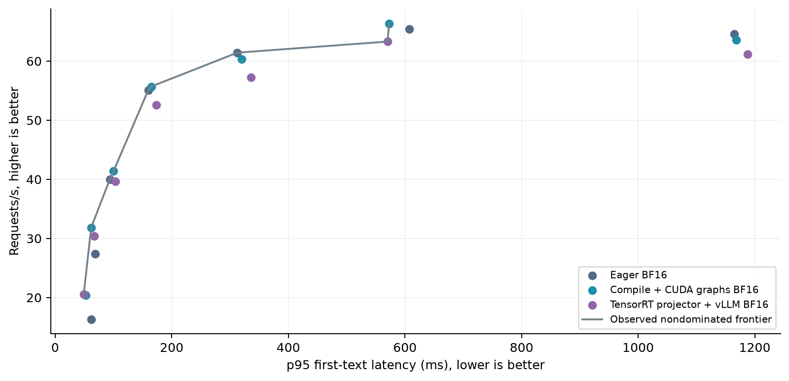
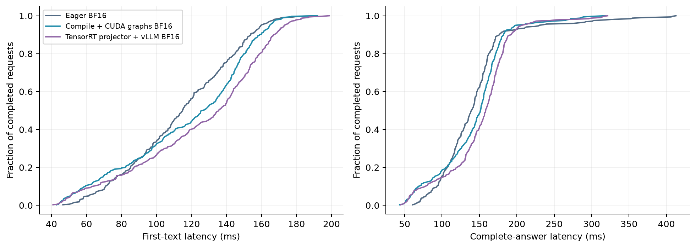

# Container replication measurements

21 cells; 6,720 attempted requests. 64 unique audio examples, including 32 unique yes/no questions. Each full cell replays them five times; quality sample size remains 32.

| Configuration | C | OK / attempts | Requests/s | TTFT p50 ms | TTFT p95 ms | E2E p95 ms | Yes/no % |
|---|---:|---:|---:|---:|---:|---:|---:|
| [Eager BF16](eager_c1.jsonl) | 1 | 320/320 | 16.34 | 47.12 | 61.99 | 106.66 | 81.250 |
| [Eager BF16](eager_c2.jsonl) | 2 | 320/320 | 27.43 | 60.26 | 68.75 | 123.64 | 81.250 |
| [Eager BF16](eager_c4.jsonl) | 4 | 320/320 | 39.97 | 80.05 | 93.73 | 179.94 | 81.250 |
| [Eager BF16](eager_c8.jsonl) | 8 | 320/320 | 55.09 | 114.93 | 159.75 | 230.35 | 81.250 |
| [Eager BF16](eager_c16.jsonl) | 16 | 320/320 | 61.43 | 206.95 | 312.58 | 401.15 | 81.250 |
| [Eager BF16](eager_c32.jsonl) | 32 | 320/320 | 65.43 | 325.14 | 607.67 | 882.79 | 81.250 |
| [Eager BF16](eager_c64.jsonl) | 64 | 320/320 | 64.57 | 701.28 | 1164.77 | 1478.50 | 81.250 |
| [Compile + CUDA graphs BF16](graphs_c1.jsonl) | 1 | 320/320 | 20.39 | 40.15 | 52.66 | 82.68 | 81.250 |
| [Compile + CUDA graphs BF16](graphs_c2.jsonl) | 2 | 320/320 | 31.85 | 56.89 | 61.87 | 105.16 | 81.250 |
| [Compile + CUDA graphs BF16](graphs_c4.jsonl) | 4 | 320/320 | 41.40 | 88.13 | 100.25 | 130.76 | 81.250 |
| [Compile + CUDA graphs BF16](graphs_c8.jsonl) | 8 | 320/320 | 55.70 | 126.53 | 164.84 | 199.12 | 81.250 |
| [Compile + CUDA graphs BF16](graphs_c16.jsonl) | 16 | 320/320 | 60.36 | 233.66 | 319.95 | 364.14 | 81.250 |
| [Compile + CUDA graphs BF16](graphs_c32.jsonl) | 32 | 320/320 | 66.35 | 315.31 | 572.85 | 886.50 | 81.250 |
| [Compile + CUDA graphs BF16](graphs_c64.jsonl) | 64 | 320/320 | 63.58 | 741.31 | 1168.39 | 1456.78 | 81.250 |
| [TensorRT projector + vLLM BF16](trt_projector_c1.jsonl) | 1 | 320/320 | 20.53 | 40.06 | 49.07 | 80.80 | 84.375 |
| [TensorRT projector + vLLM BF16](trt_projector_c2.jsonl) | 2 | 320/320 | 30.37 | 60.00 | 66.89 | 103.20 | 84.375 |
| [TensorRT projector + vLLM BF16](trt_projector_c4.jsonl) | 4 | 320/320 | 39.65 | 90.99 | 103.50 | 158.85 | 83.125 |
| [TensorRT projector + vLLM BF16](trt_projector_c8.jsonl) | 8 | 320/320 | 52.62 | 135.60 | 173.39 | 206.77 | 83.125 |
| [TensorRT projector + vLLM BF16](trt_projector_c16.jsonl) | 16 | 320/320 | 57.24 | 268.83 | 335.96 | 388.25 | 81.250 |
| [TensorRT projector + vLLM BF16](trt_projector_c32.jsonl) | 32 | 320/320 | 63.30 | 325.55 | 570.13 | 944.68 | 81.250 |
| [TensorRT projector + vLLM BF16](trt_projector_c64.jsonl) | 64 | 320/320 | 61.13 | 768.55 | 1187.30 | 1579.12 | 81.250 |

[All metrics CSV](summary.csv) · [JSON](summary.json) · [Raw SHA-256](raw_sha256.json)

The CSV includes p50/p90/p95/p99/max/mean timing, throughput, output-token rate, exact match and token F1. Raw JSONL retains every answer, reference, usage count and stream-completion status.

TTFT ends at the first nonempty text delta; E2E ends after the full stream. Both include queueing and audio preprocessing. Inputs are preloaded/base64-encoded before timing. Greedy decoding, max 64 output tokens, stop IDs 151644/151645/151667, two excluded warmups per cell. Caches are disabled. Natural answer lengths vary.

TensorRT replaces the acoustic projector with an FP16-enabled plan; the vLLM encoder and decoder remain BF16. This port differs from upstream dual-stream Kimi-Audio. These short held-out trials do not establish a production SLA or general quality equivalence.
