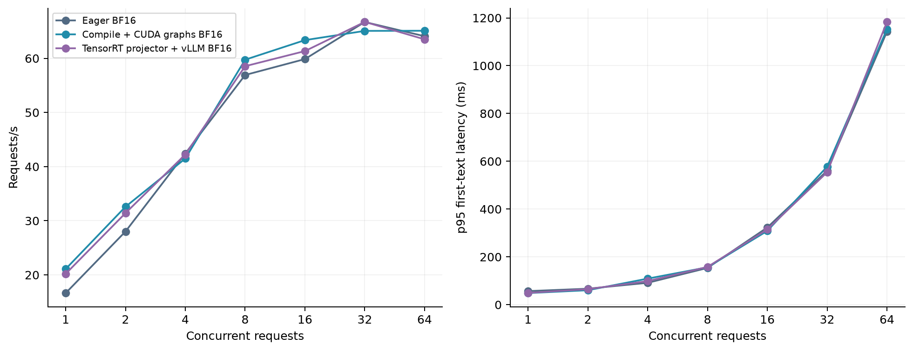
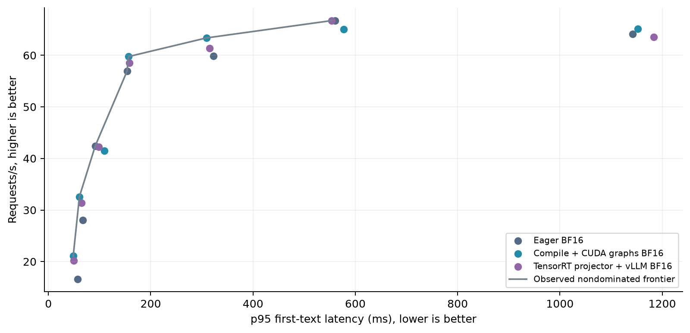
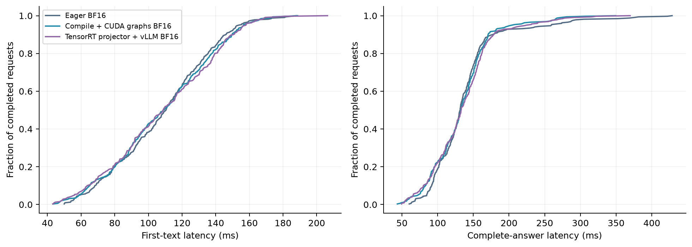

# Original host measurements

21 cells; 6,720 attempted requests. 64 unique audio examples, including 32 unique yes/no questions. Each full cell replays them five times; quality sample size remains 32.

| Configuration | C | OK / attempts | Requests/s | TTFT p50 ms | TTFT p95 ms | E2E p95 ms | Yes/no % |
|---|---:|---:|---:|---:|---:|---:|---:|
| [Eager BF16](eager_c1.jsonl) | 1 | 320/320 | 16.64 | 46.45 | 56.79 | 100.15 | 81.250 |
| [Eager BF16](eager_c2.jsonl) | 2 | 320/320 | 28.01 | 58.97 | 66.91 | 125.36 | 81.250 |
| [Eager BF16](eager_c4.jsonl) | 4 | 320/320 | 42.42 | 77.97 | 91.53 | 167.91 | 81.250 |
| [Eager BF16](eager_c8.jsonl) | 8 | 320/320 | 56.92 | 110.50 | 153.76 | 259.32 | 81.250 |
| [Eager BF16](eager_c16.jsonl) | 16 | 320/320 | 59.86 | 227.61 | 323.01 | 412.99 | 81.250 |
| [Eager BF16](eager_c32.jsonl) | 32 | 320/320 | 66.71 | 300.48 | 560.54 | 906.63 | 81.250 |
| [Eager BF16](eager_c64.jsonl) | 64 | 320/320 | 64.09 | 708.47 | 1142.26 | 1534.56 | 81.250 |
| [Compile + CUDA graphs BF16](graphs_c1.jsonl) | 1 | 320/320 | 21.09 | 38.59 | 48.48 | 80.48 | 81.250 |
| [Compile + CUDA graphs BF16](graphs_c2.jsonl) | 2 | 320/320 | 32.58 | 54.98 | 60.58 | 103.28 | 81.250 |
| [Compile + CUDA graphs BF16](graphs_c4.jsonl) | 4 | 320/320 | 41.49 | 85.23 | 109.08 | 147.07 | 81.250 |
| [Compile + CUDA graphs BF16](graphs_c8.jsonl) | 8 | 320/320 | 59.75 | 109.27 | 156.48 | 204.23 | 81.250 |
| [Compile + CUDA graphs BF16](graphs_c16.jsonl) | 16 | 320/320 | 63.36 | 213.99 | 308.78 | 366.19 | 81.250 |
| [Compile + CUDA graphs BF16](graphs_c32.jsonl) | 32 | 320/320 | 65.07 | 328.22 | 577.52 | 878.28 | 81.250 |
| [Compile + CUDA graphs BF16](graphs_c64.jsonl) | 64 | 320/320 | 65.10 | 720.53 | 1152.51 | 1432.34 | 81.250 |
| [TensorRT projector + vLLM BF16](trt_projector_c1.jsonl) | 1 | 320/320 | 20.20 | 40.59 | 49.28 | 80.16 | 84.375 |
| [TensorRT projector + vLLM BF16](trt_projector_c2.jsonl) | 2 | 320/320 | 31.41 | 57.73 | 64.94 | 99.52 | 84.375 |
| [TensorRT projector + vLLM BF16](trt_projector_c4.jsonl) | 4 | 320/320 | 42.24 | 83.86 | 98.75 | 149.37 | 81.875 |
| [TensorRT projector + vLLM BF16](trt_projector_c8.jsonl) | 8 | 320/320 | 58.55 | 108.80 | 157.98 | 224.84 | 81.250 |
| [TensorRT projector + vLLM BF16](trt_projector_c16.jsonl) | 16 | 320/320 | 61.34 | 227.27 | 314.79 | 382.42 | 81.250 |
| [TensorRT projector + vLLM BF16](trt_projector_c32.jsonl) | 32 | 320/320 | 66.73 | 309.02 | 554.05 | 892.01 | 81.250 |
| [TensorRT projector + vLLM BF16](trt_projector_c64.jsonl) | 64 | 320/320 | 63.51 | 733.97 | 1183.12 | 1425.18 | 81.250 |

[All metrics CSV](summary.csv) · [JSON](summary.json) · [Raw SHA-256](raw_sha256.json)

The CSV includes p50/p90/p95/p99/max/mean timing, throughput, output-token rate, exact match and token F1. Raw JSONL retains every answer, reference, usage count and stream-completion status.

TTFT ends at the first nonempty text delta; E2E ends after the full stream. Both include queueing and audio preprocessing. Inputs are preloaded/base64-encoded before timing. Greedy decoding, max 64 output tokens, stop IDs 151644/151645/151667, two excluded warmups per cell. Caches are disabled. Natural answer lengths vary.

TensorRT replaces the acoustic projector with an FP16-enabled plan; the vLLM encoder and decoder remain BF16. This port differs from upstream dual-stream Kimi-Audio. These short held-out trials do not establish a production SLA or general quality equivalence.
